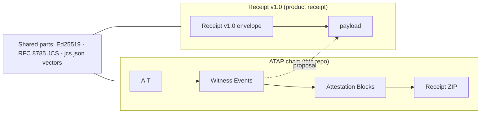

# ATAP — Agent Trust Attestation Protocol

> **Part of TunnelMind — a research house. Facts, not verdicts.**
> Four lenses on one signed corpus: **Scry** (*who is attacking?*) · **Sigil** (*who can you trust?*) · **Tracker** (*who is watching?*) · **GhostRoute** (*where does traffic actually go?*). Exhibits return as Ed25519-signed receipts (RFC 8785 JCS) that verify offline without trusting TunnelMind; the same receipt is the foundation of the accountability kit for agents that spend money (public demo: [tunnelmind.ai/weather](https://tunnelmind.ai/weather)).
> This repo serves: **the open protocol layer.** ATAP is Apache-2.0 / CC-BY-4.0; its witness-signed hash chains are a dialect of their own, beside Receipt v1, and back the cross-lens verdicts the Data API emits. See [tunnelmind.ai](https://tunnelmind.ai).

**ATAP v0.1** is an open protocol for **agent behavioral attestation**: a
witness-signed hash-chain protocol for recording what agents did, so that
the principal of an agentic system — the operator, the compliance officer,
the auditor — can verify that record in chronological order without
trusting the agent's self-report. It is not TunnelMind's product receipt;
that is Receipt v1.0 (see [What ATAP is for](#what-atap-is-for)).

- **Standard:** [`ATAP-v0.1.md`](./ATAP-v0.1.md) in this repo is the canonical text. The site's spec pages were retired on 2026-08-02 (`tunnelmind.ai/atap/standard` now redirects to `/standards`); `tunnelmind.ai/atap/keys`, the schemas, `context.jsonld` and `verify.sh` stay served so issued receipts verify forever.
- **Status:** v0.1 in force. The public comment window closed **2026-08-12**.
- **License:** CC BY 4.0 (spec — `ATAP-v0.1.md`) · Apache-2.0 (code, schemas, verifier)
- **Editor:** TunnelMind

## What's in this repo

| Path | Purpose |
|---|---|
| [`ATAP-v0.1.md`](./ATAP-v0.1.md) | The canonical specification. |
| [`ATAP-v0.2.md`](./ATAP-v0.2.md) | DRAFT delta to v0.1: did:key witnesses. Not published; v0.1 remains the standard in force. |
| [`schemas/v0.1/`](./schemas/v0.1/) | JSON Schemas for AIT, Witness Event, Attestation Block, Receipt, and the public-key endpoint. |
| [`context.jsonld`](./context.jsonld) | JSON-LD context for ATAP artifacts. |
| [`verify.sh`](./verify.sh) | Reference verifier (bash + openssl + jq + python3). Anyone can audit it in one sitting. |
| [`packages/atap-js/`](./packages/atap-js/) | Reference TypeScript wrapper — `@tunnelmindai/atap` on npm. |
| [`packages/atap-cli/`](./packages/atap-cli/) | `atap-witness` — file-backed witness CLI (`@tunnelmindai/atap-cli`), JSON on stdin and stdout. Source checkout only, not on npm. |
| [`packages/atap-py/`](./packages/atap-py/) | `atap` — Python client of `atap-witness`: `atap.code` helpers for the code_crew profile, `run_tests`, `session`, `verify`. Source checkout only, not on PyPI. |
| [`plugins/claude-code/`](./plugins/claude-code/) | Claude Code plugin that records commits and test runs as witness events. |
| [`actions/witness/`](./actions/witness/) | GitHub Action that witnesses a CI test run under an ephemeral did:key and uploads its Receipt (self-asserted: integrity only). |
| [`viewer/`](./viewer/) | One-file receipt viewer (`dist/atap-viewer.html`): open it, drop a Receipt ZIP, it verifies in the browser. Nothing is uploaded. |

## What ATAP is for

ATAP is the crew's **conduct ledger**: the hash-chained, witness-signed
record of what the crew's agents did. It records:

- **events** — one Witness Event per action (commits, test runs, tool calls), rolled up into Attestation Blocks and exported as a Receipt ZIP;
- **owner approvals** — the owner's yes on a gated step, recorded as a `code_crew:approval` event on the same chain ([code_crew profile](./profiles/profiles/tunnelmind-code-crew-v1/profile.md));
- **operator-signed constraints** — limits the operator signs and the harness checks before each tool call (`atap-witness constraints check`). They are a guard rail against accidents and drift, **not a sandbox**: they do not confine an agent or a process that bypasses them (review A-4);
- the **`data_model:v1` profile** — a draft on `origin/crew/data-model-v1-fix-1` (and `origin/profile/data-model-v1`), **unmerged**; it is not on `main` and not in [`profiles/profiles/`](./profiles/profiles/).

**Receipt v1.0 is the product receipt.** ATAP defines no competing product
receipt. ATAP's signatures are its own shapes (AIT and manifest: Ed25519
over JCS of the document minus `witness_signature`; blocks and events:
Ed25519 over the raw 32-byte `self_hash`), and they share only three
building blocks with Receipt v1.0: **Ed25519**, **RFC 8785 JCS**, and the
frozen JCS vectors [`packages/atap-js/test/vectors/jcs.json`](./packages/atap-js/test/vectors/jcs.json)
(byte-identical to receipt-verify's copy, sha256-pinned).



The dashed edge is a proposal only (below): today no witness event is a
Receipt v1.0 payload.

## Proposal: remove or freeze if unused (not done)

A proposal, **not acted on**: nothing is removed, frozen or merged by
this change. Each item lists its current users, measured on this branch
with `grep -rn --exclude-dir=node_modules --exclude-dir=dist --exclude-dir=.git --exclude-dir=specs`
(and the item's own directory excluded).

| Item | Proposal | Current users (measured) |
|---|---|---|
| `eat/` + `packages/eat-js` | Remove or freeze: unpublished JWS draft. | Pattern `eat-js\|eat/\|EAT-PROFILE`: `.github/workflows/publish.yml:39` (`working-directory: packages/eat-js`); docs only otherwise — this README's Profiles section (the `eat/` row and its note), `ARCHITECTURE.md:16,66`, `CHANGELOG.md:115`, `docs/RETIREMENT-R-06.md:13,32`. No code imports it. |
| `profiles/profiles/sigil-media-buyer-v1` | Remove or freeze: pre-pivot profile. | Pattern `sigil-media-buyer`: `profiles/registry.json:12`, `profiles/package.json:8` (the `generate` script), `profiles/README.md:22`. |
| SCITT export (`packages/atap-js/src/scitt.ts`, `atap-witness scitt export\|verify\|register`) | Remove unless a consumer exists. | Pattern `scitt\|toSignedStatement\|verifySignedStatement`, tests excluded: only its own wiring — `packages/atap-js/src/index.ts:37` (re-export), `packages/atap-cli/src/cli.ts:47,49,114-116,541-667,941-993` (the CLI path), `packages/atap-cli/README.md:77-320`, `ARCHITECTURE.md:11`, `CHANGELOG.md:212-220`; plus `scitt/` skip rules in `verify.sh:568-597`, `packages/atap-js/src/verify.ts:546`, `packages/atap-cli/src/cli.ts:388-395`, `viewer/src/main.js:62-64`. No caller outside this repo's own code and tests found. |
| `profiles/.github/workflows/validate.yml` | Remove: dead subtree workflow (GitHub never runs it). | Pattern `validate\.yml\|profiles/.github`: `.github/workflows/profiles-validate.yml:5` and `docs/RETIREMENT-R-06.md:22` (both say it never runs). Nothing invokes it. |
| `verify.sh` inside every Receipt ZIP (A-10) | Stop bundling it; verify with a trusted copy. | Pattern `verify\.sh` (69 files hit with `grep -rln`, this README included, mostly docs and tests; these are the ones that bundle or require it): **`ATAP-v0.1.md:424` — normative MUST** ("Receipts MUST contain … `verify.sh`"), so dropping it is a spec change, not only a code change; `ATAP-v0.1.md:366` (manifest example); `packages/atap-cli/src/cli.ts:96,318,339` (writes it into the ZIP); `packages/atap-js/src/verify.ts:539,568`, `verify.sh:589` and its atap-py copy `packages/atap-py/src/atap/verify.sh:589` (require it as a mandatory file); `profiles/scripts/example-generator.mjs:22` (writes it into example receipts). |
| `data_model:v1` | Merge or drop the branches. | Pattern `data_model` on this branch: nothing found. Exists only on `origin/crew/data-model-v1-fix-1` and `origin/profile/data-model-v1`. |
| Witness events as Receipt v1.0 payloads | Make events Receipt v1.0 payloads so `receipt-verify` checks the crew record. | Pattern `receipt v1(\.0)? payload\|payload.*receipt v1` (case-insensitive): nothing found. Not built. |

## What ATAP solves

Today, agentic systems hand their principals an unsigned, self-reported
log of what the agent did. There is no cryptographic chain, no
independent verification path, and no way for the principal to detect
silent rewrites. ATAP gives the principal a portable Receipt ZIP that:

1. Names the agent and its declared capabilities (the **AIT**).
2. Lists every action the agent took, signed by a trusted witness service
   (**Witness Events**, hash-chained).
3. Aggregates those actions into time-bounded summaries (**Attestation
   Blocks**, also hash-chained).
4. Bundles the chain, the witness's public keys, and a verifier into a
   single ZIP that runs anywhere bash + openssl + jq + python3 are
   present (`verify.sh`).

The trust unit is the **witness service** — a service the principal
already trusts, sitting between the agent and the world it acts on.
For the v0.1 reference deployment in programmatic advertising,
[Sigil](https://tunnelmind.ai) is the witness: agents call Sigil
before each bid, Sigil sees the decision, Sigil signs and chains it.
Other domains follow the same pattern: choose a trusted interface,
make it the witness.

ATAP v0.1 does **not** specify kernel-level observation. Stronger
observation tiers (sidecar daemons, TEEs, kernel attestation) can be
added in later versions without invalidating earlier receipts or
breaking the verifier.

## Verifying a receipt

```bash
unzip ATAP-RCPT-018f3c4d-...zip -d receipt/
atap-witness verify receipt
# or, with the verify.sh from your own checkout or https://tunnelmind.ai/atap/verify.sh:
/path/to/trusted/verify.sh receipt
# ==> Verifying file integrity (manifest.files[])
#   OK   ait.json
#   OK   attestation_chain.json
#   ...
# ==> Verifying AIT witness signature
#   OK   AIT-018f3c4d-...
# ==> Walking block chain
#   OK   ATAP-AB-018f3c4d-...
# ==> Receipt verifies (blocks=N)
```

Never run the `verify.sh` inside the ZIP: it is chosen by whoever made the
receipt ([`ATAP-v0.1.1.md`](./ATAP-v0.1.1.md) §3). Run your own trusted copy
on the receipt directory, as above.

Requirements: bash 4+, openssl 3.0+ (or 1.1.1 with `-rawin`), jq 1.6+, python3.

No install: open the one-file browser viewer instead, see [`viewer/README.md`](./viewer/README.md).

## Building witness services

Install the reference TypeScript wrapper:

```bash
npm install @tunnelmindai/atap
```

See [`packages/atap-js/README.md`](./packages/atap-js/README.md) for the API.
Implementations in other languages are welcomed; conform to §7 (schemas),
§10 (hash chain), and §11 (verification) of the standard.

## Application profiles

ATAP v0.1 specifies the protocol envelope. The **vocabulary** of event
types and aggregation rules lives in **application profiles**:

| Profile | Maintainer | Status |
|---|---|---|
| `sigil:media_buyer:v1` | TunnelMind | Reference profile, ships with v0.1. |
| `tunnelmind:crew_ops:v1` | TunnelMind | Draft profile, see [`profiles/`](./profiles/profiles/tunnelmind-crew-ops-v1/profile.md). |
| `tunnelmind:agent_tools:v1` | TunnelMind | Draft profile, see [`profiles/`](./profiles/profiles/tunnelmind-agent-tools-v1/profile.md). |
| `sigil:ecommerce_buyer:v1` | TBD | Reserved. |
| `sigil:data_broker:v1` | TBD | Reserved. |

Profile proposals are PRs against the [`./profiles`](./profiles) directory of this repo.
CI (`.github/workflows/profiles-validate.yml`) validates schema conformance, the PII
prohibition (§7.6), and example round-trip (`profiles/scripts/verify-examples.mjs`).
Conformant PRs auto-merge within 7 days
absent an editorial objection. See §9 and §12.3 of the spec.

## Profiles

Two profile repos are folded into this one. Their history was carried in
by subtree merge, and the origin repos are being archived (retirement memo
R-06).

| Tree | Origin repo | Contents |
|---|---|---|
| [`profiles/`](./profiles) | [`github.com/TunnelMind/atap-profiles`](https://github.com/TunnelMind/atap-profiles) | ATAP application-profile registry. See [`profiles/README.md`](./profiles/README.md). |
| [`eat/`](./eat) | [`github.com/TunnelMind/eat-profile`](https://github.com/TunnelMind/eat-profile) | EAT profile v0.1. See [`eat/README.md`](./eat/README.md) and [`eat/EAT-PROFILE-v0.1.md`](./eat/EAT-PROFILE-v0.1.md). |

The registry's own check is `cd profiles && npm ci && npm test` (Node 20+;
needs network once to install its dev dependencies). `eat/` has no checks.
`verify.sh` stays the receipt verifier and does not run either.

## Comment, object, or contribute

- **Discussions** ([GitHub](https://github.com/TunnelMind/atap/discussions)) — open-ended feedback, questions, proposals.
- **Issues** ([GitHub](https://github.com/TunnelMind/atap/issues)) — concrete defects, contradictions, broken examples.
- **Pull requests** — editorial fixes, clarifications, new examples. Substantive changes go through Discussions first.

## Locked positions

§14 of the spec records decisions v0.1 commits to (vs items genuinely
deferred). The big ones:

- **Receipts are immutable.** No protocol-level revocation; the only
  remediation is witness-key compromise marking (§8.4).
- **Profile-domain collisions resolve as separate namespaces**, not as
  editor arbitration.
- **SHA-256 + Ed25519 are frozen at v0.1.** Post-quantum signatures
  land in v2 in parallel, not as a replacement.
- **The transparency log is a v1.x priority**, not v2.

## License

- Spec ([`ATAP-v0.1.md`](./ATAP-v0.1.md)) is licensed [CC BY 4.0](./LICENSE-SPEC).
- Everything else in this repository — JSON Schemas, JSON-LD context, the
  reference verifier ([`verify.sh`](./verify.sh)), and the reference
  TypeScript wrapper in [`packages/atap-js/`](./packages/atap-js/) — is
  licensed [Apache-2.0](./LICENSE). The Apache patent grant is the reason
  for the change from earlier MIT; the spec text continues under CC BY 4.0
  so it remains free to cite and republish under the long-standing
  standards-text norm.

You may cite, redistribute, fork, and build on ATAP without asking. The
only ask is attribution — link to [github.com/TunnelMind/atap](https://github.com/TunnelMind/atap)
when you reference the standard.
